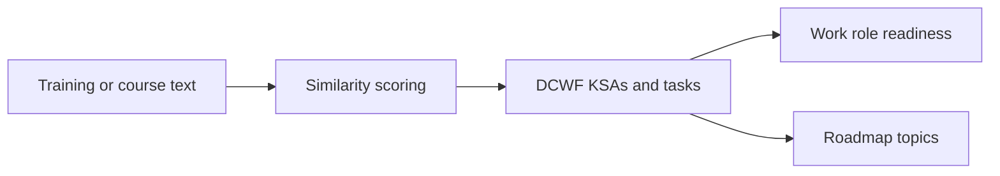

# DCWF Mapper

**Live app:** https://ryan-a-bell.github.io/dcwf-mapper/

A single-page, server-free tool that maps training, courses, and learning
roadmaps to the [DoD Cyber Workforce Framework (DCWF)](https://www.cyber.mil/dod-workforce-innovation-directorate/dod-cyber-workforce-framework/dcwf).
Everything runs in your browser from `index.html`: no backend, no build step,
no network requests. Your profile is stored only in your browser's
`localStorage`.

## What it does

| Tab | Use it to |
| --- | --- |
| **Map a source** | Paste a course or training description and see the closest DCWF KSAs and tasks, the work roles it supports, and related roadmap topics. |
| **Role readiness** | Add up your training and see which work roles it qualifies you for, and which KSAs/tasks are still uncovered. |
| **Map a catalog** | Score a whole catalog of sources at once. |

Profiles can be saved to / loaded from a file and shared by link.



## Data sources

The DCWF content embedded in `index.html` (KSAs, tasks, and work roles, with
their category and ID codes such as `DCWF-753`) comes from the official
framework published by the DoD CIO / Workforce Innovation Directorate:

- **DoD Cyber Workforce Framework (DCWF):**
  https://www.cyber.mil/dod-workforce-innovation-directorate/dod-cyber-workforce-framework/dcwf

The embedded dataset currently holds 1,667 KSAs, 1,277 tasks, and 74 work
roles, plus a set of learning-roadmap topics mapped onto them (from the
companion [developer-roadmap](https://github.com/ryan-a-bell/developer-roadmap)
repo). The build date is recorded in the data block (`meta.built`).

> This is an unofficial prototype and is not affiliated with or endorsed by the
> DoD. Similarity scores are a text-matching aid, not a qualification
> determination. Always confirm against the authoritative DCWF source above.

## Running locally

Open `index.html` directly in a browser (`file://` works), or serve the folder:

```bash
python3 -m http.server 8000
```

## Publishing on GitHub Pages

The app is one static file at the repo root, so no workflow is needed:
**Settings → Pages → Build and deployment → Source: "Deploy from a branch" →
Branch: `main` / `/ (root)` → Save.**
